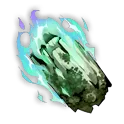
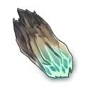

# Danh Sách Trang Bị - Swamp of Judgment (CZN)

Tổng cộng: **27** trang bị

| STT | Hình ảnh | Tên trang bị | Phẩm cấp | Loại | Chỉ số (5 Sao) | Hiệu ứng (5 Sao) |
|---|---|---|---|---|---|---|
| 1 |  | **Branch of Eternity** | Unique | Weapon (Vũ khí) | ATK: 82, DEF: 31, HP: 83 | On Heal or Recover through an ability, inflict Fixed Damage equal to 50% of Recover Amount to all enemies |
| 2 |  | **Dormant Seeds** | Unique | Accessory (Phụ kiện) | ATK: 82, DEF: 31, HP: 83 | When Shield is gained through a card, 100% Fixed Shield (1 time per turn) |
| 3 |  | **Mask of Flames** | Unique | Armor (Giáp) | ATK: 82, DEF: 31, HP: 83 | Increase Damage Amount by 35% against targets in a Vulnerable state |
| 4 |  | **Star-Lit Cloak** | Unique | Armor (Giáp) | ATK: 82, DEF: 31, HP: 83 | Decrease Damage Taken by 10% (1 time per turn) |
| 5 |  | **Verdant Shackles** | Unique | Accessory (Phụ kiện) | ATK: 82, DEF: 31, HP: 83 | +12% Attack, +12% Defense |
| 6 |  | **Bone Ring of Wildfire** | Legend | Accessory (Phụ kiện) | ATK: 82, DEF: 31, HP: 83 | When an Upgrade Card is activated, +30% Damage Amount for 1 turn |
| 7 |  | **Branch of the Evil Tree** | Legend | Weapon (Vũ khí) | ATK: 82, DEF: 31, HP: 83 | On Heal or Recover through an ability, inflict Fixed Damage equal to 50% of Recover Amount to a random enemy |
| 8 |  | **Branch of the Sacred Tree** | Legend | Weapon (Vũ khí) | ATK: 82, DEF: 31, HP: 83 | On Heal or Recover through an ally ability, inflict Fixed Damage equal to 35% of Recover Amount to all enemies |
| 9 |  | **Call of the Ancient Spirit** | Legend | Accessory (Phụ kiện) | ATK: 82, DEF: 31, HP: 83 | On Critical Hit, 10% Fixed Heal |
| 10 |  | **Cavalry of Lightning** | Legend | Weapon (Vũ khí) | ATK: 82, DEF: 31, HP: 83 | When Damage is dealt to a target possessing Shield, +100% Damage Amount to the next activated Attack Card |
| 11 |  | **Dagger That Tricked the Shadow** | Legend | Weapon (Vũ khí) | ATK: 82, DEF: 31, HP: 83 | +12% Critical Damage |
| 12 |  | **Fairy King’s Crown** | Legend | Armor (Giáp) | ATK: 82, DEF: 31, HP: 83 | +6% Critical Chance |
| 13 |  | **Immortal Scale** | Legend | Armor (Giáp) | ATK: 82, DEF: 31, HP: 83 | When gaining Counterattack through an ability, add 1 Counterattack |
| 14 |  | **Lead-Colored Holy Water** | Legend | Accessory (Phụ kiện) | ATK: 82, DEF: 31, HP: 83 | On Ravage, 2 Impair to the target |
| 15 |  | **Ring of the Seraphim** | Legend | Armor (Giáp) | ATK: 82, DEF: 31, HP: 83 | When an Upgrade Card is activated, +30% Damage Amount for 1 turn |
| 16 |  | **Sun-Setting Bow** | Legend | Weapon (Vũ khí) | ATK: 82, DEF: 31, HP: 83 | Increase Damage Amount of Attack Cards with a Cost of 2 or higher by 30% (1 time per turn) |
| 17 |  | **Sword Reflected in the Lake** | Legend | Weapon (Vũ khí) | ATK: 82, DEF: 31, HP: 83 | When there are 6 or more cards in hand, increase Damage Amount by 25% |
| 18 |  | **The Flower of Life** | Legend | Weapon (Vũ khí) | ATK: 82, DEF: 31, HP: 83 | If at max HP, +50% Damage Amount |
| 19 |  | **The Golden Rule** | Legend | Accessory (Phụ kiện) | ATK: 82, DEF: 31, HP: 83 | +20% Damage Amount, +20 Shield gain |
| 20 |  | **Verdant Day** | Legend | Accessory (Phụ kiện) | ATK: 82, DEF: 31, HP: 83 | On odd turns, +8% Attack, +12% Defense |
| 21 |  | **Verdant Night** | Legend | Accessory (Phụ kiện) | ATK: 82, DEF: 31, HP: 83 | On even turns, +12% Attack, +8% Defense |
| 22 |  | **Viadeus’s Reactor** | Legend | Accessory (Phụ kiện) | ATK: 82, DEF: 31, HP: 83 | When an Upgrade Card is activated, 1 Damage Reduction |
| 23 |  | **Wings of Light** | Legend | Armor (Giáp) | ATK: 82, DEF: 31, HP: 83 | When Ego Points are 3 or lower, 0.2 Ego Points on Critical Hit |
| 24 |  | **Clover of the Forest** | Rare | Accessory (Phụ kiện) | ATK: 82, DEF: 31, HP: 83 | On Recover through a card, +10% Attack to allies for 1 turn (max 1 stack) |
| 25 |  | **Mask of Evil Spirits** | Rare | Armor (Giáp) | ATK: 82, DEF: 31, HP: 83 | At the start of the next turn after taking Damage, 60% Fixed Shield |
| 26 |  | **Poacher’s Pathfinder** | Rare | Accessory (Phụ kiện) | ATK: 82, DEF: 31, HP: 83 | In Sekred battle, +25% Damage, 2 Vulnerable to all enemies |
| 27 |  | **The Fading Flower of Life** | Rare | Weapon (Vũ khí) | ATK: 82, DEF: 31, HP: 83 | If at max HP, +40% Damage Amount |

## Chi Tiết Từng Trang Bị

### 1. Branch of Eternity

- **Phẩm cấp**: Unique
- **Loại**: Weapon (Vũ khí)
- **Khu vực**: Swamp of Judgment
- **Link ảnh gốc**: [https://cdn.czndecksmeta.com/item/relics/relic_1304.webp](https://cdn.czndecksmeta.com/item/relics/relic_1304.webp)
- **File ảnh đã tải**: `images/branch-of-eternity.webp`

**Chỉ số qua các cấp sao:**

| Cấp | ATK | DEF | HP |
|---|---|---|---|
| S1 | 28 | 10 | 22 |
| S2 | 45 | 17 | 41 |
| S3 | 62 | 23 | 60 |
| S4 | 74 | 27 | 73 |
| S5 | 82 | 31 | 83 |

**Hiệu ứng:**

- **S1**: On Heal or Recover through an ability, inflict Fixed Damage equal to 50% of Recover Amount to all enemies
- **S2**: On Heal or Recover through an ability, inflict Fixed Damage equal to 50% of Recover Amount to all enemies
- **S3**: On Heal or Recover through an ability, inflict Fixed Damage equal to 50% of Recover Amount to all enemies
- **S4**: On Heal or Recover through an ability, inflict Fixed Damage equal to 50% of Recover Amount to all enemies
- **S5**: On Heal or Recover through an ability, inflict Fixed Damage equal to 50% of Recover Amount to all enemies

---

### 2. Dormant Seeds

- **Phẩm cấp**: Unique
- **Loại**: Accessory (Phụ kiện)
- **Khu vực**: Swamp of Judgment
- **Link ảnh gốc**: [https://cdn.czndecksmeta.com/item/relics/relic_1112.webp](https://cdn.czndecksmeta.com/item/relics/relic_1112.webp)
- **File ảnh đã tải**: `images/dormant-seeds.webp`

**Chỉ số qua các cấp sao:**

| Cấp | ATK | DEF | HP |
|---|---|---|---|
| S1 | 28 | 10 | 22 |
| S2 | 45 | 17 | 41 |
| S3 | 62 | 23 | 60 |
| S4 | 74 | 27 | 73 |
| S5 | 82 | 31 | 83 |

**Hiệu ứng:**

- **S1**: When Shield is gained through a card, 100% Fixed Shield (1 time per turn)
- **S2**: When Shield is gained through a card, 100% Fixed Shield (1 time per turn)
- **S3**: When Shield is gained through a card, 100% Fixed Shield (1 time per turn)
- **S4**: When Shield is gained through a card, 100% Fixed Shield (1 time per turn)
- **S5**: When Shield is gained through a card, 100% Fixed Shield (1 time per turn)

---

### 3. Mask of Flames

- **Phẩm cấp**: Unique
- **Loại**: Armor (Giáp)
- **Khu vực**: Swamp of Judgment
- **Link ảnh gốc**: [https://cdn.czndecksmeta.com/item/relics/relic_1115.webp](https://cdn.czndecksmeta.com/item/relics/relic_1115.webp)
- **File ảnh đã tải**: `images/mask-of-flames.webp`

**Chỉ số qua các cấp sao:**

| Cấp | ATK | DEF | HP |
|---|---|---|---|
| S1 | 28 | 10 | 22 |
| S2 | 45 | 17 | 41 |
| S3 | 62 | 23 | 60 |
| S4 | 74 | 27 | 73 |
| S5 | 82 | 31 | 83 |

**Hiệu ứng:**

- **S1**: Increase Damage Amount by 35% against targets in a Vulnerable state
- **S2**: Increase Damage Amount by 35% against targets in a Vulnerable state
- **S3**: Increase Damage Amount by 35% against targets in a Vulnerable state
- **S4**: Increase Damage Amount by 35% against targets in a Vulnerable state
- **S5**: Increase Damage Amount by 35% against targets in a Vulnerable state

---

### 4. Star-Lit Cloak

- **Phẩm cấp**: Unique
- **Loại**: Armor (Giáp)
- **Khu vực**: Swamp of Judgment
- **Link ảnh gốc**: [https://cdn.czndecksmeta.com/item/relics/relic_1189.webp](https://cdn.czndecksmeta.com/item/relics/relic_1189.webp)
- **File ảnh đã tải**: `images/star-lit-cloak.webp`

**Chỉ số qua các cấp sao:**

| Cấp | ATK | DEF | HP |
|---|---|---|---|
| S1 | 28 | 10 | 22 |
| S2 | 45 | 17 | 41 |
| S3 | 62 | 23 | 60 |
| S4 | 74 | 27 | 73 |
| S5 | 82 | 31 | 83 |

**Hiệu ứng:**

- **S1**: Decrease Damage Taken by 10% (1 time per turn)
- **S2**: Decrease Damage Taken by 10% (1 time per turn)
- **S3**: Decrease Damage Taken by 10% (1 time per turn)
- **S4**: Decrease Damage Taken by 10% (1 time per turn)
- **S5**: Decrease Damage Taken by 10% (1 time per turn)

---

### 5. Verdant Shackles

- **Phẩm cấp**: Unique
- **Loại**: Accessory (Phụ kiện)
- **Khu vực**: Swamp of Judgment
- **Link ảnh gốc**: [https://cdn.czndecksmeta.com/item/relics/relic_1307.webp](https://cdn.czndecksmeta.com/item/relics/relic_1307.webp)
- **File ảnh đã tải**: `images/verdant-shackles.webp`

**Chỉ số qua các cấp sao:**

| Cấp | ATK | DEF | HP |
|---|---|---|---|
| S1 | 28 | 10 | 22 |
| S2 | 45 | 17 | 41 |
| S3 | 62 | 23 | 60 |
| S4 | 74 | 27 | 73 |
| S5 | 82 | 31 | 83 |

**Hiệu ứng:**

- **S1**: +12% Attack, +12% Defense
- **S2**: +12% Attack, +12% Defense
- **S3**: +12% Attack, +12% Defense
- **S4**: +12% Attack, +12% Defense
- **S5**: +12% Attack, +12% Defense

---

### 6. Bone Ring of Wildfire

- **Phẩm cấp**: Legend
- **Loại**: Accessory (Phụ kiện)
- **Khu vực**: Swamp of Judgment
- **Link ảnh gốc**: [https://cdn.czndecksmeta.com/item/relics/relic_1113.webp](https://cdn.czndecksmeta.com/item/relics/relic_1113.webp)
- **File ảnh đã tải**: `images/bone-ring-of-wildfire.webp`

**Chỉ số qua các cấp sao:**

| Cấp | ATK | DEF | HP |
|---|---|---|---|
| S1 | 28 | 10 | 22 |
| S2 | 45 | 17 | 41 |
| S3 | 62 | 23 | 60 |
| S4 | 74 | 27 | 73 |
| S5 | 82 | 31 | 83 |

**Hiệu ứng:**

- **S1**: When an Upgrade Card is activated, +30% Damage Amount for 1 turn
- **S2**: When an Upgrade Card is activated, +30% Damage Amount for 1 turn
- **S3**: When an Upgrade Card is activated, +30% Damage Amount for 1 turn
- **S4**: When an Upgrade Card is activated, +30% Damage Amount for 1 turn
- **S5**: When an Upgrade Card is activated, +30% Damage Amount for 1 turn

---

### 7. Branch of the Evil Tree

- **Phẩm cấp**: Legend
- **Loại**: Weapon (Vũ khí)
- **Khu vực**: Swamp of Judgment
- **Link ảnh gốc**: [https://cdn.czndecksmeta.com/item/relics/relic_1303.webp](https://cdn.czndecksmeta.com/item/relics/relic_1303.webp)
- **File ảnh đã tải**: `images/branch-of-the-evil-tree.webp`

**Chỉ số qua các cấp sao:**

| Cấp | ATK | DEF | HP |
|---|---|---|---|
| S1 | 28 | 10 | 22 |
| S2 | 45 | 17 | 41 |
| S3 | 62 | 23 | 60 |
| S4 | 74 | 27 | 73 |
| S5 | 82 | 31 | 83 |

**Hiệu ứng:**

- **S1**: On Heal or Recover through an ability, inflict Fixed Damage equal to 50% of Recover Amount to a random enemy
- **S2**: On Heal or Recover through an ability, inflict Fixed Damage equal to 50% of Recover Amount to a random enemy
- **S3**: On Heal or Recover through an ability, inflict Fixed Damage equal to 50% of Recover Amount to a random enemy
- **S4**: On Heal or Recover through an ability, inflict Fixed Damage equal to 50% of Recover Amount to a random enemy
- **S5**: On Heal or Recover through an ability, inflict Fixed Damage equal to 50% of Recover Amount to a random enemy

---

### 8. Branch of the Sacred Tree

- **Phẩm cấp**: Legend
- **Loại**: Weapon (Vũ khí)
- **Khu vực**: Swamp of Judgment
- **Link ảnh gốc**: [https://cdn.czndecksmeta.com/item/relics/relic_1061.webp](https://cdn.czndecksmeta.com/item/relics/relic_1061.webp)
- **File ảnh đã tải**: `images/branch-of-the-sacred-tree.webp`

**Chỉ số qua các cấp sao:**

| Cấp | ATK | DEF | HP |
|---|---|---|---|
| S1 | 28 | 10 | 22 |
| S2 | 45 | 17 | 41 |
| S3 | 62 | 23 | 60 |
| S4 | 74 | 27 | 73 |
| S5 | 82 | 31 | 83 |

**Hiệu ứng:**

- **S1**: On Heal or Recover through an ally ability, inflict Fixed Damage equal to 35% of Recover Amount to all enemies
- **S2**: On Heal or Recover through an ally ability, inflict Fixed Damage equal to 35% of Recover Amount to all enemies
- **S3**: On Heal or Recover through an ally ability, inflict Fixed Damage equal to 35% of Recover Amount to all enemies
- **S4**: On Heal or Recover through an ally ability, inflict Fixed Damage equal to 35% of Recover Amount to all enemies
- **S5**: On Heal or Recover through an ally ability, inflict Fixed Damage equal to 35% of Recover Amount to all enemies

---

### 9. Call of the Ancient Spirit

- **Phẩm cấp**: Legend
- **Loại**: Accessory (Phụ kiện)
- **Khu vực**: Swamp of Judgment
- **Link ảnh gốc**: [https://cdn.czndecksmeta.com/item/relics/relic_1116.webp](https://cdn.czndecksmeta.com/item/relics/relic_1116.webp)
- **File ảnh đã tải**: `images/call-of-the-ancient-spirit.webp`

**Chỉ số qua các cấp sao:**

| Cấp | ATK | DEF | HP |
|---|---|---|---|
| S1 | 28 | 10 | 22 |
| S2 | 45 | 17 | 41 |
| S3 | 62 | 23 | 60 |
| S4 | 74 | 27 | 73 |
| S5 | 82 | 31 | 83 |

**Hiệu ứng:**

- **S1**: On Critical Hit, 10% Fixed Heal
- **S2**: On Critical Hit, 10% Fixed Heal
- **S3**: On Critical Hit, 10% Fixed Heal
- **S4**: On Critical Hit, 10% Fixed Heal
- **S5**: On Critical Hit, 10% Fixed Heal

---

### 10. Cavalry of Lightning

- **Phẩm cấp**: Legend
- **Loại**: Weapon (Vũ khí)
- **Khu vực**: Swamp of Judgment
- **Link ảnh gốc**: [https://cdn.czndecksmeta.com/item/relics/relic_1095.webp](https://cdn.czndecksmeta.com/item/relics/relic_1095.webp)
- **File ảnh đã tải**: `images/cavalry-of-lightning.webp`

**Chỉ số qua các cấp sao:**

| Cấp | ATK | DEF | HP |
|---|---|---|---|
| S1 | 28 | 10 | 22 |
| S2 | 45 | 17 | 41 |
| S3 | 62 | 23 | 60 |
| S4 | 74 | 27 | 73 |
| S5 | 82 | 31 | 83 |

**Hiệu ứng:**

- **S1**: When Damage is dealt to a target possessing Shield, +100% Damage Amount to the next activated Attack Card
- **S2**: When Damage is dealt to a target possessing Shield, +100% Damage Amount to the next activated Attack Card
- **S3**: When Damage is dealt to a target possessing Shield, +100% Damage Amount to the next activated Attack Card
- **S4**: When Damage is dealt to a target possessing Shield, +100% Damage Amount to the next activated Attack Card
- **S5**: When Damage is dealt to a target possessing Shield, +100% Damage Amount to the next activated Attack Card

---

### 11. Dagger That Tricked the Shadow

- **Phẩm cấp**: Legend
- **Loại**: Weapon (Vũ khí)
- **Khu vực**: Swamp of Judgment
- **Link ảnh gốc**: [https://cdn.czndecksmeta.com/item/relics/relic_1231.webp](https://cdn.czndecksmeta.com/item/relics/relic_1231.webp)
- **File ảnh đã tải**: `images/dagger-that-tricked-the-shadow.webp`

**Chỉ số qua các cấp sao:**

| Cấp | ATK | DEF | HP |
|---|---|---|---|
| S1 | 28 | 10 | 22 |
| S2 | 45 | 17 | 41 |
| S3 | 62 | 23 | 60 |
| S4 | 74 | 27 | 73 |
| S5 | 82 | 31 | 83 |

**Hiệu ứng:**

- **S1**: +12% Critical Damage
- **S2**: +12% Critical Damage
- **S3**: +12% Critical Damage
- **S4**: +12% Critical Damage
- **S5**: +12% Critical Damage

---

### 12. Fairy King’s Crown

- **Phẩm cấp**: Legend
- **Loại**: Armor (Giáp)
- **Khu vực**: Swamp of Judgment
- **Link ảnh gốc**: [https://cdn.czndecksmeta.com/item/relics/relic_1062.webp](https://cdn.czndecksmeta.com/item/relics/relic_1062.webp)
- **File ảnh đã tải**: `images/fairy-kings-crown.webp`

**Chỉ số qua các cấp sao:**

| Cấp | ATK | DEF | HP |
|---|---|---|---|
| S1 | 28 | 10 | 22 |
| S2 | 45 | 17 | 41 |
| S3 | 62 | 23 | 60 |
| S4 | 74 | 27 | 73 |
| S5 | 82 | 31 | 83 |

**Hiệu ứng:**

- **S1**: +6% Critical Chance
- **S2**: +6% Critical Chance
- **S3**: +6% Critical Chance
- **S4**: +6% Critical Chance
- **S5**: +6% Critical Chance

---

### 13. Immortal Scale

- **Phẩm cấp**: Legend
- **Loại**: Armor (Giáp)
- **Khu vực**: Swamp of Judgment
- **Link ảnh gốc**: [https://cdn.czndecksmeta.com/item/relics/relic_1114.webp](https://cdn.czndecksmeta.com/item/relics/relic_1114.webp)
- **File ảnh đã tải**: `images/immortal-scale.webp`

**Chỉ số qua các cấp sao:**

| Cấp | ATK | DEF | HP |
|---|---|---|---|
| S1 | 28 | 10 | 22 |
| S2 | 45 | 17 | 41 |
| S3 | 62 | 23 | 60 |
| S4 | 74 | 27 | 73 |
| S5 | 82 | 31 | 83 |

**Hiệu ứng:**

- **S1**: When gaining Counterattack through an ability, add 1 Counterattack
- **S2**: When gaining Counterattack through an ability, add 1 Counterattack
- **S3**: When gaining Counterattack through an ability, add 1 Counterattack
- **S4**: When gaining Counterattack through an ability, add 1 Counterattack
- **S5**: When gaining Counterattack through an ability, add 1 Counterattack

---

### 14. Lead-Colored Holy Water

- **Phẩm cấp**: Legend
- **Loại**: Accessory (Phụ kiện)
- **Khu vực**: Swamp of Judgment
- **Link ảnh gốc**: [https://cdn.czndecksmeta.com/item/relics/relic_0002.webp](https://cdn.czndecksmeta.com/item/relics/relic_0002.webp)
- **File ảnh đã tải**: `images/lead-colored-holy-water.webp`

**Chỉ số qua các cấp sao:**

| Cấp | ATK | DEF | HP |
|---|---|---|---|
| S1 | 28 | 10 | 22 |
| S2 | 45 | 17 | 41 |
| S3 | 62 | 23 | 60 |
| S4 | 74 | 27 | 73 |
| S5 | 82 | 31 | 83 |

**Hiệu ứng:**

- **S1**: On Ravage, 2 Impair to the target
- **S2**: On Ravage, 2 Impair to the target
- **S3**: On Ravage, 2 Impair to the target
- **S4**: On Ravage, 2 Impair to the target
- **S5**: On Ravage, 2 Impair to the target

---

### 15. Ring of the Seraphim

- **Phẩm cấp**: Legend
- **Loại**: Armor (Giáp)
- **Khu vực**: Swamp of Judgment
- **Link ảnh gốc**: [https://cdn.czndecksmeta.com/item/relics/relic_1181.webp](https://cdn.czndecksmeta.com/item/relics/relic_1181.webp)
- **File ảnh đã tải**: `images/ring-of-the-seraphim.webp`

**Chỉ số qua các cấp sao:**

| Cấp | ATK | DEF | HP |
|---|---|---|---|
| S1 | 28 | 10 | 22 |
| S2 | 45 | 17 | 41 |
| S3 | 62 | 23 | 60 |
| S4 | 74 | 27 | 73 |
| S5 | 82 | 31 | 83 |

**Hiệu ứng:**

- **S1**: When an Upgrade Card is activated, +30% Damage Amount for 1 turn
- **S2**: When an Upgrade Card is activated, +30% Damage Amount for 1 turn
- **S3**: When an Upgrade Card is activated, +30% Damage Amount for 1 turn
- **S4**: When an Upgrade Card is activated, +30% Damage Amount for 1 turn
- **S5**: When an Upgrade Card is activated, +30% Damage Amount for 1 turn

---

### 16. Sun-Setting Bow

- **Phẩm cấp**: Legend
- **Loại**: Weapon (Vũ khí)
- **Khu vực**: Swamp of Judgment
- **Link ảnh gốc**: [https://cdn.czndecksmeta.com/item/relics/relic_1191.webp](https://cdn.czndecksmeta.com/item/relics/relic_1191.webp)
- **File ảnh đã tải**: `images/sun-setting-bow.webp`

**Chỉ số qua các cấp sao:**

| Cấp | ATK | DEF | HP |
|---|---|---|---|
| S1 | 28 | 10 | 22 |
| S2 | 45 | 17 | 41 |
| S3 | 62 | 23 | 60 |
| S4 | 74 | 27 | 73 |
| S5 | 82 | 31 | 83 |

**Hiệu ứng:**

- **S1**: Increase Damage Amount of Attack Cards with a Cost of 2 or higher by 30% (1 time per turn)
- **S2**: Increase Damage Amount of Attack Cards with a Cost of 2 or higher by 30% (1 time per turn)
- **S3**: Increase Damage Amount of Attack Cards with a Cost of 2 or higher by 30% (1 time per turn)
- **S4**: Increase Damage Amount of Attack Cards with a Cost of 2 or higher by 30% (1 time per turn)
- **S5**: Increase Damage Amount of Attack Cards with a Cost of 2 or higher by 30% (1 time per turn)

---

### 17. Sword Reflected in the Lake

- **Phẩm cấp**: Legend
- **Loại**: Weapon (Vũ khí)
- **Khu vực**: Swamp of Judgment
- **Link ảnh gốc**: [https://cdn.czndecksmeta.com/item/relics/relic_1187.webp](https://cdn.czndecksmeta.com/item/relics/relic_1187.webp)
- **File ảnh đã tải**: `images/sword-reflected-in-the-lake.webp`

**Chỉ số qua các cấp sao:**

| Cấp | ATK | DEF | HP |
|---|---|---|---|
| S1 | 28 | 10 | 22 |
| S2 | 45 | 17 | 41 |
| S3 | 62 | 23 | 60 |
| S4 | 74 | 27 | 73 |
| S5 | 82 | 31 | 83 |

**Hiệu ứng:**

- **S1**: When there are 6 or more cards in hand, increase Damage Amount by 25%
- **S2**: When there are 6 or more cards in hand, increase Damage Amount by 25%
- **S3**: When there are 6 or more cards in hand, increase Damage Amount by 25%
- **S4**: When there are 6 or more cards in hand, increase Damage Amount by 25%
- **S5**: When there are 6 or more cards in hand, increase Damage Amount by 25%

---

### 18. The Flower of Life

- **Phẩm cấp**: Legend
- **Loại**: Weapon (Vũ khí)
- **Khu vực**: Swamp of Judgment
- **Link ảnh gốc**: [https://cdn.czndecksmeta.com/item/relics/relic_1302.webp](https://cdn.czndecksmeta.com/item/relics/relic_1302.webp)
- **File ảnh đã tải**: `images/the-flower-of-life.webp`

**Chỉ số qua các cấp sao:**

| Cấp | ATK | DEF | HP |
|---|---|---|---|
| S1 | 28 | 10 | 22 |
| S2 | 45 | 17 | 41 |
| S3 | 62 | 23 | 60 |
| S4 | 74 | 27 | 73 |
| S5 | 82 | 31 | 83 |

**Hiệu ứng:**

- **S1**: If at max HP, +50% Damage Amount
- **S2**: If at max HP, +50% Damage Amount
- **S3**: If at max HP, +50% Damage Amount
- **S4**: If at max HP, +50% Damage Amount
- **S5**: If at max HP, +50% Damage Amount

---

### 19. The Golden Rule

- **Phẩm cấp**: Legend
- **Loại**: Accessory (Phụ kiện)
- **Khu vực**: Swamp of Judgment
- **Link ảnh gốc**: [https://cdn.czndecksmeta.com/item/relics/relic_1180.webp](https://cdn.czndecksmeta.com/item/relics/relic_1180.webp)
- **File ảnh đã tải**: `images/the-golden-rule.webp`

**Chỉ số qua các cấp sao:**

| Cấp | ATK | DEF | HP |
|---|---|---|---|
| S1 | 28 | 10 | 22 |
| S2 | 45 | 17 | 41 |
| S3 | 62 | 23 | 60 |
| S4 | 74 | 27 | 73 |
| S5 | 82 | 31 | 83 |

**Hiệu ứng:**

- **S1**: +20% Damage Amount, +20 Shield gain
- **S2**: +20% Damage Amount, +20 Shield gain
- **S3**: +20% Damage Amount, +20 Shield gain
- **S4**: +20% Damage Amount, +20 Shield gain
- **S5**: +20% Damage Amount, +20 Shield gain

---

### 20. Verdant Day

- **Phẩm cấp**: Legend
- **Loại**: Accessory (Phụ kiện)
- **Khu vực**: Swamp of Judgment
- **Link ảnh gốc**: [https://cdn.czndecksmeta.com/item/relics/relic_1305.webp](https://cdn.czndecksmeta.com/item/relics/relic_1305.webp)
- **File ảnh đã tải**: `images/verdant-day.webp`

**Chỉ số qua các cấp sao:**

| Cấp | ATK | DEF | HP |
|---|---|---|---|
| S1 | 28 | 10 | 22 |
| S2 | 45 | 17 | 41 |
| S3 | 62 | 23 | 60 |
| S4 | 74 | 27 | 73 |
| S5 | 82 | 31 | 83 |

**Hiệu ứng:**

- **S1**: On odd turns, +8% Attack, +12% Defense
- **S2**: On odd turns, +8% Attack, +12% Defense
- **S3**: On odd turns, +8% Attack, +12% Defense
- **S4**: On odd turns, +8% Attack, +12% Defense
- **S5**: On odd turns, +8% Attack, +12% Defense

---

### 21. Verdant Night

- **Phẩm cấp**: Legend
- **Loại**: Accessory (Phụ kiện)
- **Khu vực**: Swamp of Judgment
- **Link ảnh gốc**: [https://cdn.czndecksmeta.com/item/relics/relic_1306.webp](https://cdn.czndecksmeta.com/item/relics/relic_1306.webp)
- **File ảnh đã tải**: `images/verdant-night.webp`

**Chỉ số qua các cấp sao:**

| Cấp | ATK | DEF | HP |
|---|---|---|---|
| S1 | 28 | 10 | 22 |
| S2 | 45 | 17 | 41 |
| S3 | 62 | 23 | 60 |
| S4 | 74 | 27 | 73 |
| S5 | 82 | 31 | 83 |

**Hiệu ứng:**

- **S1**: On even turns, +12% Attack, +8% Defense
- **S2**: On even turns, +12% Attack, +8% Defense
- **S3**: On even turns, +12% Attack, +8% Defense
- **S4**: On even turns, +12% Attack, +8% Defense
- **S5**: On even turns, +12% Attack, +8% Defense

---

### 22. Viadeus’s Reactor

- **Phẩm cấp**: Legend
- **Loại**: Accessory (Phụ kiện)
- **Khu vực**: Swamp of Judgment
- **Link ảnh gốc**: [https://cdn.czndecksmeta.com/item/relics/relic_1099.webp](https://cdn.czndecksmeta.com/item/relics/relic_1099.webp)
- **File ảnh đã tải**: `images/viadeuss-reactor.webp`

**Chỉ số qua các cấp sao:**

| Cấp | ATK | DEF | HP |
|---|---|---|---|
| S1 | 28 | 10 | 22 |
| S2 | 45 | 17 | 41 |
| S3 | 62 | 23 | 60 |
| S4 | 74 | 27 | 73 |
| S5 | 82 | 31 | 83 |

**Hiệu ứng:**

- **S1**: When an Upgrade Card is activated, 1 Damage Reduction
- **S2**: When an Upgrade Card is activated, 1 Damage Reduction
- **S3**: When an Upgrade Card is activated, 1 Damage Reduction
- **S4**: When an Upgrade Card is activated, 1 Damage Reduction
- **S5**: When an Upgrade Card is activated, 1 Damage Reduction

---

### 23. Wings of Light

- **Phẩm cấp**: Legend
- **Loại**: Armor (Giáp)
- **Khu vực**: Swamp of Judgment
- **Link ảnh gốc**: [https://cdn.czndecksmeta.com/item/relics/relic_1179.webp](https://cdn.czndecksmeta.com/item/relics/relic_1179.webp)
- **File ảnh đã tải**: `images/wings-of-light.webp`

**Chỉ số qua các cấp sao:**

| Cấp | ATK | DEF | HP |
|---|---|---|---|
| S1 | 28 | 10 | 22 |
| S2 | 45 | 17 | 41 |
| S3 | 62 | 23 | 60 |
| S4 | 74 | 27 | 73 |
| S5 | 82 | 31 | 83 |

**Hiệu ứng:**

- **S1**: When Ego Points are 3 or lower, 0.2 Ego Points on Critical Hit
- **S2**: When Ego Points are 3 or lower, 0.2 Ego Points on Critical Hit
- **S3**: When Ego Points are 3 or lower, 0.2 Ego Points on Critical Hit
- **S4**: When Ego Points are 3 or lower, 0.2 Ego Points on Critical Hit
- **S5**: When Ego Points are 3 or lower, 0.2 Ego Points on Critical Hit

---

### 24. Clover of the Forest

- **Phẩm cấp**: Rare
- **Loại**: Accessory (Phụ kiện)
- **Khu vực**: Swamp of Judgment
- **Link ảnh gốc**: [https://cdn.czndecksmeta.com/item/relics/relic_1232.webp](https://cdn.czndecksmeta.com/item/relics/relic_1232.webp)
- **File ảnh đã tải**: `images/clover-of-the-forest.webp`

**Chỉ số qua các cấp sao:**

| Cấp | ATK | DEF | HP |
|---|---|---|---|
| S1 | 28 | 10 | 22 |
| S2 | 45 | 17 | 41 |
| S3 | 62 | 23 | 60 |
| S4 | 74 | 27 | 73 |
| S5 | 82 | 31 | 83 |

**Hiệu ứng:**

- **S1**: On Recover through a card, +10% Attack to allies for 1 turn (max 1 stack)
- **S2**: On Recover through a card, +10% Attack to allies for 1 turn (max 1 stack)
- **S3**: On Recover through a card, +10% Attack to allies for 1 turn (max 1 stack)
- **S4**: On Recover through a card, +10% Attack to allies for 1 turn (max 1 stack)
- **S5**: On Recover through a card, +10% Attack to allies for 1 turn (max 1 stack)

---

### 25. Mask of Evil Spirits

- **Phẩm cấp**: Rare
- **Loại**: Armor (Giáp)
- **Khu vực**: Swamp of Judgment
- **Link ảnh gốc**: [https://cdn.czndecksmeta.com/item/relics/relic_1117.webp](https://cdn.czndecksmeta.com/item/relics/relic_1117.webp)
- **File ảnh đã tải**: `images/mask-of-evil-spirits.webp`

**Chỉ số qua các cấp sao:**

| Cấp | ATK | DEF | HP |
|---|---|---|---|
| S1 | 28 | 10 | 22 |
| S2 | 45 | 17 | 41 |
| S3 | 62 | 23 | 60 |
| S4 | 74 | 27 | 73 |
| S5 | 82 | 31 | 83 |

**Hiệu ứng:**

- **S1**: At the start of the next turn after taking Damage, 60% Fixed Shield
- **S2**: At the start of the next turn after taking Damage, 60% Fixed Shield
- **S3**: At the start of the next turn after taking Damage, 60% Fixed Shield
- **S4**: At the start of the next turn after taking Damage, 60% Fixed Shield
- **S5**: At the start of the next turn after taking Damage, 60% Fixed Shield

---

### 26. Poacher’s Pathfinder

- **Phẩm cấp**: Rare
- **Loại**: Accessory (Phụ kiện)
- **Khu vực**: Swamp of Judgment
- **Link ảnh gốc**: [https://cdn.czndecksmeta.com/item/relics/relic_1160.webp](https://cdn.czndecksmeta.com/item/relics/relic_1160.webp)
- **File ảnh đã tải**: `images/poachers-pathfinder.webp`

**Chỉ số qua các cấp sao:**

| Cấp | ATK | DEF | HP |
|---|---|---|---|
| S1 | 28 | 10 | 22 |
| S2 | 45 | 17 | 41 |
| S3 | 62 | 23 | 60 |
| S4 | 74 | 27 | 73 |
| S5 | 82 | 31 | 83 |

**Hiệu ứng:**

- **S1**: In Sekred battle, +25% Damage, 2 Vulnerable to all enemies
- **S2**: In Sekred battle, +25% Damage, 2 Vulnerable to all enemies
- **S3**: In Sekred battle, +25% Damage, 2 Vulnerable to all enemies
- **S4**: In Sekred battle, +25% Damage, 2 Vulnerable to all enemies
- **S5**: In Sekred battle, +25% Damage, 2 Vulnerable to all enemies

---

### 27. The Fading Flower of Life

- **Phẩm cấp**: Rare
- **Loại**: Weapon (Vũ khí)
- **Khu vực**: Swamp of Judgment
- **Link ảnh gốc**: [https://cdn.czndecksmeta.com/item/relics/relic_1301.webp](https://cdn.czndecksmeta.com/item/relics/relic_1301.webp)
- **File ảnh đã tải**: `images/the-fading-flower-of-life.webp`

**Chỉ số qua các cấp sao:**

| Cấp | ATK | DEF | HP |
|---|---|---|---|
| S1 | 28 | 10 | 22 |
| S2 | 45 | 17 | 41 |
| S3 | 62 | 23 | 60 |
| S4 | 74 | 27 | 73 |
| S5 | 82 | 31 | 83 |

**Hiệu ứng:**

- **S1**: If at max HP, +40% Damage Amount
- **S2**: If at max HP, +40% Damage Amount
- **S3**: If at max HP, +40% Damage Amount
- **S4**: If at max HP, +40% Damage Amount
- **S5**: If at max HP, +40% Damage Amount

---

