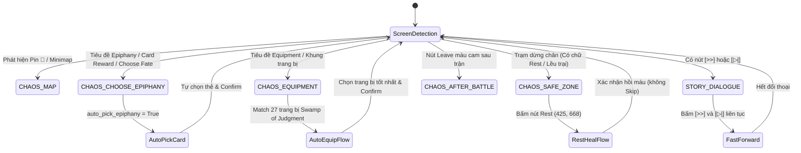

# Spec: Chaos Bot Intelligence & Autonomous Overhaul

## 1. Objective
Nâng cấp toàn diện trí thông minh và tự động hóa 100% không người can thiệp cho chế độ **Chaos Mode** của game *Chaos Zero Nightmare* trên độ phân giải cố định 1600x900 (BlueStacks):
- **Tách và hoàn thiện State `CHAOS_EQUIPMENT`:** Nhận diện màn hình gán trang bị, tự động so khớp mẫu ảnh trong `templates/swamp_of_judgment_equipment/images/` và tính điểm theo `templates/equipment_rules.json`, chọn trang bị tốt nhất và bấm xác nhận trang bị dứt khoát.
- **Triệt tiêu nhầm lẫn thị giác:** Phân tách rạch ròi 100% giữa màn hình Gắn trang bị và Trạm dừng chân (`CHAOS_SAFE_ZONE`), không để nút Skip/Confirm bị nhận diện chéo.
- **Trạm dừng chân (`CHAOS_SAFE_ZONE`):** Luôn luôn ưu tiên bấm **Rest (Hồi máu)** tại tọa độ chuẩn hoặc qua OCR kể cả khi HP đang là 100%, sau đó xác nhận hồi máu; không bấm bỏ qua (Skip).
- **Tự động chọn thẻ bài (`CHAOS_CHOOSE_EPIPHANY`):** Bật mặc định `auto_pick_epiphany = True`, tự động đánh giá và chọn thẻ ngay sau 1-2 khung hình ổn định, nạp kho dữ liệu 403 thẻ bài từ `templates/card_rules.json`.
- **Tự động tua nhanh đối thoại sự kiện (`STORY_DIALOGUE`):** Gỡ bỏ logic chặn skip trong Chaos mode, tự động tap Auto `[>>]` và Skip `[▷|]`.
- **Dọn dẹp mã nguồn cũ (Clean Refactor):** Xóa bỏ các đoạn tap tọa độ mù cứng `(500, 350) -> (1150, 520)`, loại bỏ code chờ thủ công, dọn dẹp các đường dẫn template không dùng.

---

## 2. Capability Map & Modules

| Module ID | Trách nhiệm | Phụ thuộc | File dự kiến |
| :--- | :--- | :--- | :--- |
| `chaos-detector-refactor` | Bổ sung `State.CHAOS_EQUIPMENT` vào enum và detector; phân tách đặc trưng độc lập giữa `CHAOS_EQUIPMENT` và `CHAOS_SAFE_ZONE`. | `config.py` | `config.py`, `detector.py`, `chaos_state_machine.py` |
| `chaos-equipment-engine` | Nạp CSDL 27 trang bị `templates/equipment_rules.json` & template ảnh `templates/swamp_of_judgment_equipment/`; phân tích và tự động gắn trang bị theo độ ưu tiên Tier S > A > B. | `chaos-detector-refactor`, `chaos_vision` | `chaos_vision.py`, `chaos_ai_brain.py`, `bot_engine.py` |
| `chaos-safe-zone-rest` | Xử lý Trạm dừng chân: tìm tọa độ nút **Rest** (Hồi máu) bằng OCR/tọa độ cố định `(425, 668)`, bấm chọn hồi máu và xác nhận modal, loại bỏ hành vi bấm Skip. | `ocr_service`, `bot_engine` | `bot_engine.py`, `chaos_state_machine.py` |
| `chaos-dialogue-skip` | Sửa `_handle_story_dialogue` trong Mode.CHAOS để tự động bấm Skip `[▷|]` và Auto `[>>]`, không dừng lại chờ. | `bot_engine` | `bot_engine.py` |
| `chaos-card-autopick` | Kích hoạt mặc định `auto_pick_epiphany = True` trong Engine; liên kết kho 403 thẻ `templates/card_rules.json` vào Heuristic fallback. | `chaos_ai_config`, `bot_engine` | `chaos_ai_config.py`, `bot_engine.py` |
| `chaos-cleanup` | Xóa bỏ chuỗi tap mù tọa độ cũ `(500, 350) -> (1150, 520)` trong `_handle_chaos_after_battle` và các cờ chờ không dùng. | `bot_engine` | `bot_engine.py` |

---

## 3. Detailed Technical Design

### 3.1. Phân định Trạng thái (Resolution: 1600x900)



### 3.2. Chi tiết Module `chaos-detector-refactor`
1. **Enum `State.CHAOS_EQUIPMENT`**:
   - Thêm `State.CHAOS_EQUIPMENT = "CHAOS_EQUIPMENT"` vào `config.py`.
2. **Quy tắc nhận diện phân biệt (Disambiguation Rules)**:
   - **`CHAOS_EQUIPMENT`**:
     - Kiểm tra tiêu đề `equipment_title` tại `(650, 70, 350, 110)`.
     - HOẶC OCR phát hiện từ khóa `"Equipment"`, `"Trang bị"`, `"Obtain Equipment"`.
     - Phải kiểm tra trước khi kiểm tra nút `chaos_safe_zone_skip` để tránh nhận diện nhầm.
   - **`CHAOS_SAFE_ZONE`**:
     - Kiểm tra tiêu đề `"Safe Zone"` hoặc nút `"Rest"` / `"Campfire"` / `"Available Safe Zone Interactions"`.
     - Template `chaos_safe_zone_skip` tại `(1200, 750, 380, 140)` chỉ được coi là Safe Zone nếu KHÔNG khớp `equipment_title`.

### 3.3. Chi tiết Module `chaos-equipment-engine`
1. **Dữ liệu nguồn:**
   - File JSON: `templates/equipment_rules.json` (chứa 27 trang bị thế giới Swamp of Judgment).
   - Thư mục ảnh template: `templates/swamp_of_judgment_equipment/images/*.webp`.
2. **Quy trình xử lý màn hình trang bị (`_handle_chaos_equipment`):**
   - Bước 1: Quét vùng hiển thị các trang bị được tặng/chọn (thường nằm ở trung tâm màn hình `X: 400 ~ 1200, Y: 250 ~ 650`).
   - Bước 2: So khớp template với 27 ảnh `.webp` (hoặc OCR tên tiếng Anh của trang bị).
   - Bước 3: Lấy điểm `priority` từ `equipment_rules.json`:
     - Tier S (`priority: 90-100`): ví dụ `Branch of Eternity` (95), `Verdant Shackles` (93).
     - Tier A (`priority: 80-89`).
     - Tier B/C (`priority: 30-79`).
     - Mặc định: Chọn trang bị có điểm cao nhất. Nếu không nhận dạng được tên cụ thể, chọn vị trí ô trang bị đầu tiên `(800, 450)`.
   - Bước 4: Chạm chọn trang bị, chạm chọn nhân vật nhận (hoặc nút Equip tự động), và bấm nút Confirm tại `TAP_COORDS["equipment_confirm"]` `(1360, 806)`.
   - Xóa bỏ chuỗi tap mù `(500, 350) -> (1150, 520) -> (1360, 806)`.

### 3.4. Chi tiết Module `chaos-safe-zone-rest`
1. **Nút Rest (Hồi máu):**
   - Vị trí chuẩn trên màn hình Safe Zone: `(425, 668)` (vùng `X: 350 ~ 500, Y: 600 ~ 720`).
   - Kết hợp OCR `ocr.find_text(screen, "Rest")` để lấy tọa độ động chính xác.
2. **Quy trình xử lý Trạm dừng chân (`_handle_chaos_safe_zone`):**
   - Bước 1: Ghi log: `Trạng thái: CHAOS_SAFE_ZONE -> Chọn Rest (Hồi máu toàn đội)...`
   - Bước 2: Bấm vào nút **Rest** tại `(425, 668)`.
   - Bước 3: Chờ 0.6s để popup xác nhận hồi máu hiển thị.
   - Bước 4: Bấm nút xác nhận hồi máu (tọa độ confirm `(956, 568)` hoặc nút Confirm ở giữa màn hình).
   - Bước 5: Chờ 0.8s để hoạt ảnh hồi máu kết thúc. Nếu sau đó màn hình xuất hiện nút rời đi / tiếp tục, bấm để trở về bản đồ.
   - **Tuyệt đối không bấm nút Skip `(1506, 828)` khi vào Safe Zone.**

### 3.5. Chi tiết Module `chaos-dialogue-skip`
- Trong `bot_engine.py` hàm `_handle_story_dialogue`:
  - Xóa bỏ đoạn:
    ```python
    if self.mode == Mode.CHAOS:
        if self._last_state != State.STORY_DIALOGUE:
            self.log(f"⚠️ Trạng thái: STORY_DIALOGUE ... -> Bỏ qua, không tự động skip cốt truyện.")
        return True
    ```
  - Thay thế bằng logic: Bất kể ở `Mode.STORY` hay `Mode.CHAOS`, khi gặp `State.STORY_DIALOGUE`, bot tự động gửi lệnh tap vào nút Auto `[>>]` `(1395, 48)` và nút tua nhanh Skip `[▷|]` `(1272, 48)` để đối thoại trôi qua nhanh nhất.

### 3.6. Chi tiết Module `chaos-card-autopick` & `chaos-cleanup`
- Trong `bot_engine.py`:
  - Khởi tạo `self.auto_pick_epiphany = True` mặc định khi bot chạy chế độ `Mode.CHAOS`.
- Trong `chaos_ai_config.py`:
  - Kiểm tra và tự động nạp `templates/card_rules.json` (403 thẻ) và `templates/event_rules.json` (4300 dòng) làm nguồn dữ liệu chuẩn cho Heuristic engine và AI prompt.
- Trong `_handle_chaos_after_battle`:
  - Chuyển toàn bộ logic `is_equipment` sang state handler độc lập `_handle_chaos_equipment`. `_handle_chaos_after_battle` chỉ phụ trách duy nhất việc bấm nút cam `Leave` quay lại bản đồ.

---

## 4. Test & Verification Plan

### 4.1. Lệnh kiểm thử
```bash
# Kiểm tra bộ unit test phát hiện màn hình:
python -m unittest tests/test_chaos_detector.py

# Kiểm tra bộ test tích hợp bot engine:
python -m unittest tests/test_bot_engine.py

# Kiểm tra toàn bộ 47+ unit tests của dự án:
python -m unittest discover tests
```

### 4.2. Tiêu chí nghiệm thu (Acceptance Criteria)
1. `test_detect_chaos_equipment`: Nhận diện ảnh có `equipment_title` thành `State.CHAOS_EQUIPMENT` (không còn là `CHAOS_AFTER_BATTLE`).
2. `test_detect_chaos_safe_zone`: Nhận diện `chaos_safe_zone.png` thành `State.CHAOS_SAFE_ZONE` và phân biệt không trùng với `CHAOS_EQUIPMENT`.
3. `test_safe_zone_always_heals`: Giả lập vào Safe Zone, xác nhận bot chạm vào nút Rest `(425, 668)` và confirm, không chạm vào nút Skip `(1506, 828)`.
4. `test_dialogue_skips_in_chaos`: Giả lập gặp `STORY_DIALOGUE` trong `Mode.CHAOS`, xác nhận bot chạm nút Skip `(1272, 48)` thay vì đứng im.
5. `test_card_reward_auto_pick_default`: Giả lập gặp `CHAOS_CHOOSE_EPIPHANY`, bot tự động ra quyết định chọn thẻ và confirm mà không cần người dùng thao tác.

