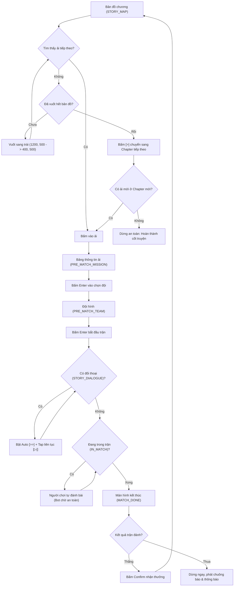

# Spec: Story Mode Auto Progression

## 1. Objective

Xây dựng tính năng tự động cày chế độ **Cốt truyện (Story Mode)** trong game *Chaos Zero Nightmare* trên độ phân giải cố định 1600x900 (BlueStacks):
- **Bản đồ cốt truyện (`STORY_MAP`)**: Tự động phát hiện ải tiếp theo (biểu tượng `story_node_play` hoặc nhãn `N` màu cam).
- **Vuốt bản đồ**: Tự động vuốt từ phải sang trái nếu ải tiếp theo ở ngoài tầm nhìn màn hình.
- **Tự động chuyển chương**: Khi đã hoàn thành tất cả các ải của chương hiện tại, tự động bấm nút `[>]` trên thanh Chapter để sang chương tiếp theo. Nếu chương mới chưa mở, dừng an toàn.
- **Vào ải (`PRE_MATCH_MISSION` & `PRE_MATCH_TEAM`)**: Tự động bấm `Enter` mở bảng thông tin và bấm `Enter` bắt đầu trận.
- **Bỏ qua hội thoại (`STORY_DIALOGUE`)**: Do cốt truyện có nhiều câu thoại và chuyển cảnh liên tiếp ("không chỉ nhấn skip 1 lần là xong"), bot duy trì vòng lặp kích hoạt Auto `[>>]` và liên tục tap nút tua nhanh `[▷|]` cho tới khi hội thoại kết thúc hoàn toàn.
- **Trong trận đánh (`IN_MATCH`)**: Do game khóa nút Auto trong cốt truyện (*"This feature cannot be used in the Story"*), bot chuyển sang chế độ thụ động an toàn để người chơi tự tay đánh bài.
- **Kết thúc ải (`MATCH_DONE`)**:
  - Nếu Chiến thắng: Tự động bấm `Confirm` nhận thưởng và quay lại bản đồ chương tiếp tục ải kế tiếp.
  - Nếu Thất bại: Dừng bot ngay lập tức, phát chuông báo và gửi thông báo (Telegram/Discord).

---

## 2. Capability Map & Modules

| Module ID | Trách nhiệm | File liên quan |
| :--- | :--- | :--- |
| `story-config` | Định nghĩa `Mode.STORY`, `State.STORY_MAP`, `State.STORY_DIALOGUE`, và tọa độ `TAP_COORDS`. | `config.py` |
| `story-detector` | Nhận diện bản đồ chương `STORY_MAP`, phát hiện node ải tiếp theo, và nhận diện màn hình hội thoại `STORY_DIALOGUE`. | `detector.py`, `templates/` |
| `story-engine` | Triển khai handler `_handle_story_map`, `_handle_story_dialogue`, và cập nhật `_handle_match_done` cho `Mode.STORY`. | `bot_engine.py` |
| `story-ui` | Thêm lựa chọn radiobutton "Cốt truyện" trong GUI và đối số `--mode story` trong CLI. | `gui.py`, `main.py` |
| `story-test` | Bộ unit test kiểm thử toàn diện các nhánh quyết định và state của Story Mode. | `tests/test_story_mode.py` |

---

## 3. Detailed Technical Design

### 3.1. Phân vùng tọa độ (Resolution: 1600x900)

- **Thanh Chapter trên cùng:**
  - Nút chuyển chương trước `[<]`: `(260, 45)`
  - Tên Chapter trung tâm: `(800, 45)`
  - Nút chuyển chương kế `[>]`: `(746, 45)`
- **Nút tua nhanh đối thoại `[▷|]`:**
  - Vùng tìm kiếm: `X: 1220 ~ 1320, Y: 20 ~ 80`
  - Tọa độ chạm: `(1272, 48)`
- **Nút Auto đối thoại `[>>]`:**
  - Vùng tìm kiếm: `X: 1350 ~ 1450, Y: 20 ~ 80`
  - Tọa độ chạm: `(1395, 48)`
- **Nút Enter thông tin ải (Stage Info):**
  - Tọa độ chạm: `(1290, 830)` (`TAP_COORDS["enter_mission"]`)
- **Nút Enter đội hình (Team Formation):**
  - Tọa độ chạm: `(1325, 830)` (`TAP_COORDS["enter_team"]`)
- **Nút Confirm sau trận (Victory):**
  - Tọa độ chạm: `(1405, 830)` (`TAP_COORDS["right_button"]`)

### 3.2. Cơ chế nhận diện State

1. **`State.STORY_MAP`**:
   - Nhận diện tiêu đề `Story` góc trên bên trái `(80, 15, 80, 50)` bằng template `story_title.png` HOẶC chữ "Chapter" trên thanh trên cùng.
   - Tìm vị trí ải tiếp theo:
     - Dùng template `story_node_play.png` (icon tam giác cam `▶`) trên toàn bộ khu vực giữa bản đồ `(0, 100, 1600, 700)`.
     - Kết hợp kiểm tra màu cam/vàng của badge `N` hoặc viền phát sáng của node đang hoạt động.
2. **`State.STORY_DIALOGUE`**:
   - Nhận diện nút `[▷|]` ở góc trên phải `(1220, 20, 100, 60)` qua template `story_dialogue_skip.png` HOẶC icon `[>>]` / `[▷]`.
   - Kết hợp kiểm tra hộp thoại có mũi tên tiếp tục `▽` ở góc dưới.

### 3.3. Thuật toán xử lý trong Bot Engine

